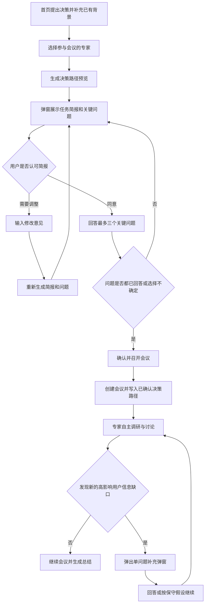

# 「决策路径」产品需求文档（PRD）

版本：1.1
日期：2026-08-05  
状态：产品方案已确认，待实现  
适用项目：斜杠 / Decision Council  
目标读者：产品、设计、前端、后端、AI 应用开发与测试人员

本次修改：明确“决策路径只确认目标，不预设专家调研路径”。删除会前任务简报中的具体调研事项，工具选择、搜索内容、调用顺序和停止条件全部由专家 Agent 在运行时自主决定。

---

## 1. 一句话定义

「决策路径」是在专家会议开始前，由 AI 将用户的模糊问题整理成可确认的任务简报，并通过少量、以选项为主的关键问题补齐信息；会议进行中如发现新的高影响信息缺口，再以单问题弹窗请求用户补充。

它解决的不是“让用户把背景写得更长”，而是帮助用户和 AI 在开始分析前共同确认：

1. 这次真正要决定什么；
2. 应比较哪些方案；
3. 哪些条件必须由用户确认；
4. 哪些信息不应继续询问用户，而应由专家在运行时自主判断是否核实；
5. 最终要交付什么可执行结果。

---

## 2. 背景与现状

### 2.1 用户问题

个人重大决策通常以一句模糊问题开始，例如：

- 要不要买房？
- 要不要接这个 Offer？
- 现在要不要买黄金？

直接进入专家分析会产生以下问题：

- 用户与 AI 对“要解决的问题”理解不一致；
- 专家缺少预算、期限、底线等只有用户知道的信息；
- AI 把公开数据问题反问给用户，增加用户负担；
- 专家只能大量使用假设，结论空泛或反复强调“信息不足”；
- 用户不知道最终会得到报告、计算、清单，还是普通聊天回复；
- 会议创建后才发现缺少信息，页面长期停留在等待状态。

### 2.2 当前产品流程

当前流程为：

`首页填写问题与背景 → 选择专家 → 创建会议 → Worker 拆解问题 → 信息门槛判断 → 必要时在会议室弹窗追问 → 专家调研`

当前实现已经具备：

- 最多三个会前追问；
- 单选、数字、短文本三类回答；
- “暂时不知道，继续分析”；
- 回答后重新进入任务队列；
- 追问状态可持久化。

但仍存在四个核心缺口：

1. 没有让用户确认 AI 对任务的理解；
2. 会议在确认前已经创建，容易产生大量 `awaiting_input` 会议；
3. 问题仍有较多文本输入，没有系统执行“选项优先”；
4. 当前是一次性会前追问，不支持会议中发现新缺口后继续询问。

---

## 3. 产品目标

### 3.1 核心目标

1. 将用户的一句话决策转化为清晰、可修改、可确认的任务简报。
2. 首次只询问最多三个真正会改变结论、且只有用户能回答的问题。
3. 问题尽量通过单选、多选或区间选项完成，实在无法结构化时才使用输入框。
4. 公开事实、市场数据和可计算信息由 AI 自行获取，不转嫁给用户。
5. 用户确认简报和关键问题后才创建会议并占用 Worker。
6. 将确认后的决策路径作为所有专家共同的任务上下文。
7. 会议中允许出现一次一个的高影响追问，但不展示模型隐式思维链。

### 3.2 用户价值

- 不需要学习如何写 Prompt；
- 不需要预先知道“应该提供哪些信息”；
- 可以纠正 AI 对决策目标的误解；
- 能在一分钟内完成必要补充；
- 在会议开始前知道最终会得到什么；
- 减少“信息不足”“无法判断”等低价值回复。

### 3.3 产品价值

- 把产品从“专家聊天”升级为“重大决策任务系统”；
- 提高专家分析的针对性、可计算性和可执行性；
- 降低无效搜索、无效 LLM 调用和暂停会议数量；
- 为买房、职业和投资三个闭环场景建立统一入口；
- 明确展示 AI 应用产品经理对模糊需求拆解和落地的能力。

### 3.4 非目标

本需求不包括：

- 重写五位专家的人物设定和回复风格；
- 改造最终总结页的信息架构；
- 让 AI 代替用户作出不可逆决定；
- 要求用户一次填完完整问卷；
- 展示模型原始思维链；
- 在本期加入登录、付费或商业化能力；
- 为所有长尾决策建立完整的垂直 Playbook。

---

## 4. 核心概念

### 4.1 决策路径

一组经过用户确认、供后续专家共同使用的结构化信息，包含：

- 用户的原始问题；
- AI 理解后的决策目标；
- 需要比较的选项；
- 本次分析重点；
- 最终交付内容；
- 用户已确认的关键条件；
- 用户暂时不知道、由系统采用保守假设处理的条件。

### 4.2 任务简报

决策路径中面向用户展示的摘要，不是内部 Prompt。任务简报必须短、具体、可确认。

固定由四个部分组成：

1. **决策目标**：本次真正要判断什么；
2. **比较方案**：至少两个可执行选项；
3. **重点分析**：本场会议重点检查的三至五个维度；
4. **最终交付**：用户会得到哪些可以直接使用的结果。

### 4.3 关键问题

同时满足以下条件才允许询问用户：

- 只有用户本人或其相关方知道；
- 很可能改变最终建议；
- 原始问题和背景中尚未提供；
- 无法通过网页搜索或计算器可靠获得；
- 可以被用户在短时间内回答。

### 4.4 保守假设

当用户选择“不确定，按保守情况估算”时，系统为该问题生成明确假设。假设必须：

- 可理解；
- 不冒充用户事实；
- 在专家上下文和最终总结中标记为“推断假设”；
- 附带结论翻转条件。

---

## 5. 目标用户与核心场景

### 5.1 目标用户

- 面临个人重大决策，但不知道如何系统拆解的人；
- 已有一些背景信息，但不确定哪些信息最重要的人；
- 希望获得多视角分析、计算和行动方案，而不是普通聊天回复的人；
- 不具备专业金融、房地产或职业咨询知识的人。

### 5.2 本期优先场景

1. 买房：是否购买、何时购买、购买哪一种方案；
2. 职业：是否接 Offer、是否跳槽、如何谈判；
3. 投资：是否配置黄金、股票、基金或某项投资。

通用场景继续支持，但只使用通用问题策略，不承诺完整垂直交付。

---

## 6. 产品原则

### 6.1 先理解，再追问，再行动

不能只向用户提问。AI 必须先展示自己对任务的理解和准备执行的工作。

### 6.2 选项优先，输入兜底

问题交互优先级固定为：

`单选 → 多选 → 区间选择 → 搜索选择 → 选项后补充 → 纯文本/数字输入`

### 6.3 不重复询问

系统应从原始问题和背景中提取已知信息。已识别的信息直接展示为“已识别”，允许用户修改，但不能再次当作问题询问。

### 6.4 只问用户专属信息

以下内容不得询问用户：

- 当前房贷利率；
- 当地购房政策和税费；
- 黄金、股票或基金的实时价格；
- 公司或行业的公开经营与招聘信息；
- 历史回撤、成交数据和公开案例；
- 可以通过计算器得到的结果。

### 6.5 首次最多三个问题

首次弹窗最多展示三个关键问题。若仍存在其他缺口：

- 低影响缺口使用假设；
- 公开缺口不询问用户，由专家在运行时自主判断是否以及如何核实；
- 新出现的高影响用户信息缺口留到会议中一次询问一个。

### 6.6 用户始终可以继续

每个问题必须支持“不确定，按保守情况估算”或等价选项。用户不应因为不知道答案而无法召开会议。

### 6.7 确认后才创建会议

用户未确认任务简报前，不创建 `parliament` 记录、不进入任务队列、不占用 Worker。

### 6.8 目标固定，路径自治

决策路径只负责确定专家要完成的目标和交付标准，不能提前替专家决定执行路径。

会前可以固定：

- 用户确认的决策目标；
- 需要比较的选项；
- 用户关心的判断标准；
- 用户事实、约束和保守假设；
- 最终必须交付的结果；
- 专家允许使用的工具、安全边界和预算。

必须由专家 Agent 在运行时自主决定：

- 当前还缺少什么信息；
- 是否需要使用工具；
- 使用网页搜索、计算器、历史记忆，还是不使用工具；
- 搜索什么、如何组织搜索词；
- 工具结果是否足够可靠；
- 是否需要继续调研、改变方法或停止；
- 最终如何把证据转化为本专业判断。

会前弹窗不得展示“AI 将搜索房贷利率、租金、成交价”等确定性调研清单。统一只展示：

> 公开信息将由专家在会议中自主判断并按需核实，实际搜索与计算会在发生后展示。

场景 Playbook 可以规定问题类型、交付标准和评测样例，但不得把具体搜索词、工具调用或执行顺序写入专家任务。

---

## 7. 完整用户流程

### 7.1 目标流程



### 7.2 页面路径

保持现有三步路径，不新增独立页面：

1. 首页：描述决策和已知背景；
2. 专家选择页：选择三至五位专家；
3. 会议室：展示调研、讨论与总结。

「决策路径」以模态弹窗形式出现在专家选择页，触发时机为用户点击“开始讨论”。

### 7.3 为什么放在专家选择页

- 用户已经完成初始表达和专家选择，进入会议意图明确；
- 弹窗确认后可以直接创建会议；
- 避免进入会议室后再被弹窗打断；
- 避免产生大量未确认的暂停会议；
- 不破坏当前首页与会议室的整体视觉路径。

---

## 8. 会前「决策路径」弹窗

### 8.1 打开条件

用户在专家选择页满足以下条件后点击“开始讨论”：

- 已有有效决策问题；
- 已选择三至五位专家；
- 当前没有正在提交的请求。

点击后：

1. 按钮进入“正在生成决策路径…”状态；
2. 前端调用决策路径预览接口；
3. 成功后打开弹窗；
4. 失败时使用场景兜底简报和问题库打开弹窗，不直接创建会议。

### 8.2 弹窗布局

桌面端为居中弹窗，最大宽度约 720px；移动端使用接近全屏的底部弹层或全屏弹窗。

```text
┌──────────────────────────────────────────────┐
│  开始前，确认一下本次会议任务                 │
│  我们只询问会明显影响结论的信息               │
│                                              │
│  本次任务简报                                │
│  ┌────────────────────────────────────────┐  │
│  │ 决策目标                               │  │
│  │ 判断你现在是否适合买房，而非单纯预测房价 │  │
│  │                                        │  │
│  │ 比较方案                               │  │
│  │ 现在购买 / 延后购买 / 继续租住          │  │
│  │                                        │  │
│  │ 重点分析                               │  │
│  │ 现金流、租买成本、持有期、生活稳定性     │  │
│  │                                        │  │
│  │ 最终交付                               │  │
│  │ 结论、计算、看房清单、谈价和行动计划     │  │
│  └────────────────────────────────────────┘  │
│                                              │
│  简报是否符合你的需求？                      │
│  ☑ 同意，按以上目标分析                      │
│  □ 需要调整                                 │
│                                              │
│  还需要你确认 3 个关键信息                   │
│  1. 这套房主要用于？                         │
│  [自住] [自住兼顾升值] [投资] [还不确定]     │
│                                              │
│  2. 预计至少居住多久？                       │
│  [3年以内] [3—5年] [5—10年] [10年以上]      │
│                                              │
│  3. 希望月供控制在收入的多少以内？            │
│  [20%] [30%] [40%] [按保守值估算]            │
│                                              │
│      [返回修改决策]    [确认并召开会议]       │
└──────────────────────────────────────────────┘
```

### 8.3 任务简报确认

“同意”和“需要调整”为互斥选项。

#### 同意

- 勾选后记录 `brief_confirmation = confirmed`；
- 用户仍需完成全部关键问题，或为每个问题选择“不确定”；
- 简报内容发生任何变化后，自动取消原“同意”状态。

#### 需要调整

选择后展开一个输入框：

```text
请告诉我们哪里理解得不准确
例如：我不是在比较租房和买房，而是在比较市区老房和郊区新房。
```

输入框下方提供“根据补充重新生成简报”按钮。

重新生成规则：

- 原简报作为上下文传给模型；
- 用户修改意见具有最高优先级；
- 保留问题 ID 未变化的已选答案；
- 删除已不相关问题及其答案；
- 新增问题显示为未回答；
- 重新生成后必须再次勾选“同意”；
- 若重新生成失败，保留原简报、修改意见和已选答案。

### 8.4 已识别信息

当用户原始描述中已包含关键事实时，在问题区上方显示：

```text
已从你的描述中识别：
✓ 城市：上海
✓ 税后月收入：4万元
✓ 可用首付：150万元
✓ 目标总价：约500万元
```

要求：

- 每项支持点击修改；
- 修改后更新结构化事实；
- 已识别信息不得再次出现在问题列表；
- 不向用户展示模型识别置信度百分比；
- 无法确定时不自动填入，改为问题。

### 8.5 底部按钮

#### 返回修改决策

- 关闭弹窗；
- 保留当前专家选择；
- 返回专家选择页当前状态；
- 用户可继续返回首页修改原问题。

#### 确认并召开会议

只有同时满足以下条件时可点击：

- 已勾选“同意”；
- 每个问题均有答案；
- “不确定”视为有效答案；
- 当前没有生成或提交请求。

点击后：

1. 按钮变为“正在创建会议…”；
2. 请求带唯一幂等键；
3. 创建成功后跳转会议室；
4. 创建失败保留弹窗全部内容，可重试；
5. 连续点击不能创建多场会议。

---

## 9. 关键问题系统

### 9.1 问题生成步骤

系统按以下顺序处理：

1. 从原始问题和背景中提取用户明确事实；
2. 识别需要比较的决策选项；
3. 生成可能影响结论的信息缺口；
4. 将缺口分为用户信息、公开事实、可计算结果和低影响假设；
5. 公开事实标记为“无需询问用户”，但不预生成固定调研清单；
6. 可计算信息进入计算任务；
7. 低影响未知使用显式假设；
8. 只对高影响用户信息生成问题；
9. 按“对结论影响 × 当前不确定程度 × 用户可回答程度”排序；
10. 只取前三个。

### 9.2 问题类型

支持以下类型：

| 类型 | 使用场景 | 示例 |
|---|---|---|
| `single_choice` | 互斥目标或状态 | 自住 / 投资 / 不确定 |
| `multi_choice` | 可同时存在的偏好 | 收入 / 成长 / 城市 / 工作强度 |
| `range_choice` | 金额、期限、比例 | 3—5年、月供占比30% |
| `choice_with_custom` | 有常见选项但允许补充 | 主要担忧 + 其他 |
| `search_select` | 城市、行业等可搜索枚举 | 上海、杭州、深圳 |
| `number` | 必须精确计算且区间不足 | 具体税后收入 |
| `short_text` | 无法合理结构化 | 具体 Offer 条款 |

### 9.3 选项规则

- 每个单选题提供二至六个互斥选项；
- 多选题最多选择三个；
- 选项应使用普通用户可以判断的语言；
- 不使用“高风险偏好”“效用函数”等术语；
- 必须包含“不确定”类选项；
- 只有选择“其他”或“输入具体值”时才展开输入框；
- 数字问题优先提供区间，再提供“输入具体金额”；
- 用户选择“不确定”时，应展示将采用的保守假设，而不是静默处理。

### 9.4 禁止问题

不得生成：

- “请详细介绍一下你的情况”；
- “你的风险偏好是什么”；
- “还有什么需要补充”；
- “你觉得市场会不会上涨”；
- 询问可公开查询的价格、政策和历史数据；
- 重复用户已经提供的信息；
- 同时询问两件互不相关事情的问题；
- 引导用户选择某个预设结论的问题。

---

## 10. 三个核心场景 Playbook

### 10.1 买房

#### 默认决策目标

判断用户在当前生活、财务和家庭条件下是否适合购买目标住房，而不是单纯预测房价涨跌。

#### 默认比较方案

- 现在购买；
- 延后六至十八个月购买；
- 继续租住并保留资金；
- 必要时增加“降低总价/更换区域”。

#### 可能的信息方向（仅用于评测，不作为固定路径）

下列内容用于验证专家是否有能力发现相关信息缺口，不在会前弹窗展示，也不直接写入专家的固定 `research_questions`。每位专家可以自主选择其中零项、一项或多项，也可以根据实际问题寻找其他信息。

- 当前房贷利率；
- 当地购房政策和交易税费；
- 目标区域成交价和租金；
- 租售比与流动性；
- 可比较房源；
- 必要的历史周期信息。

#### 用户关键信息候选池

按缺失情况动态选择最多三个：

1. 购房主要用途：自住 / 自住兼顾升值 / 投资 / 不确定；
2. 预计居住或持有期限：3年以内 / 3—5年 / 5—10年 / 10年以上 / 不确定；
3. 未来三年换城市可能性：很低 / 有可能 / 较高 / 已确定 / 不确定；
4. 可用首付区间：50万以内 / 50—100万 / 100—200万 / 200万以上 / 输入具体金额 / 不确定；
5. 可接受月供占税后收入比例：20%以内 / 20%—30% / 30%—40% / 40%以上 / 不确定；
6. 家庭意见：一致支持 / 基本支持 / 存在分歧 / 尚未讨论 / 不确定；
7. 首付后应急资金：不足6个月 / 6—12个月 / 12个月以上 / 不确定。

#### 最终交付

- 当前建议及适用条件；
- 月供、总利息和现金流压力计算；
- 租买成本及三至五年盈亏平衡分析；
- 三种市场情景下的结果；
- 预算上限和安全边界；
- 看房、核验与谈价清单；
- 未来30天行动计划；
- 结论翻转条件。

### 10.2 职业 / Offer / 跳槽

#### 默认决策目标

判断新机会是否比继续留任更符合用户的收入、成长、生活和长期职业方向，并明确可谈判条件和退出方案。

#### 默认比较方案

- 接受当前机会；
- 留在原岗位；
- 谈判后再决定；
- 延后行动并补足能力或信息。

#### 可能的信息方向（仅用于评测，不作为固定路径）

下列内容用于构造测试案例和判断工具选择是否合理，不在会前弹窗展示，也不要求每场会议逐项搜索。

- 目标行业和岗位趋势；
- 公司公开经营与融资情况；
- 同类岗位薪酬和职责；
- 通用股权、奖金和竞业条款风险；
- 所在城市与行业机会密度。

#### 用户关键信息候选池

1. 本次变化最主要想解决什么：收入 / 成长 / 管理机会 / 转行 / 工作生活 / 不确定；
2. 新机会的稳定收入变化：下降20%以上 / 基本持平 / 增长10%—30% / 增长30%以上 / 输入具体值 / 不确定；
3. 最难接受的结果：收入下降 / 发展停滞 / 工作过载 / 公司失败 / 城市变化 / 不确定；
4. 可承担收入波动时间：不足3个月 / 3—6个月 / 6—12个月 / 12个月以上 / 不确定；
5. 新机会失败后的退路：可以回原行业 / 有其他 Offer / 可休整再找 / 暂无退路 / 不确定；
6. 家庭或伴侣态度：支持 / 有条件支持 / 反对 / 尚未讨论 / 不确定；
7. 决策截止时间：一周内 / 两周内 / 一个月内 / 更久 / 输入日期。

#### 最终交付

- 接受、拒绝或谈判后接受的建议；
- 现金、股权、成长、强度与风险对比；
- 两至三年职业路径情景；
- Offer 核验清单；
- 可直接使用的 HR / 上级谈判话术；
- 退出条件和止损方案；
- 30 / 60 / 90 天行动计划；
- 结论翻转条件。

### 10.3 投资 / 黄金 / 股票

#### 默认决策目标

判断该资产是否适合用户当前的资金用途、持有期限和整体资产配置，而不是只预测短期价格。

#### 默认比较方案

- 现在一次性配置；
- 分批配置；
- 暂不配置；
- 使用其他资产实现同一目标。

#### 可能的信息方向（仅用于评测，不作为固定路径）

下列内容只用于评测 Agent 能否识别时效性和证据缺口，不在会前弹窗展示，也不作为预设执行清单。

- 最新价格与估值位置；
- 利率、汇率和宏观驱动；
- 历史回撤与波动；
- 产品费用、流动性和跟踪误差；
- 机构观点及其分歧；
- 相关资产替代方案。

#### 用户关键信息候选池

1. 主要目标：保值 / 分散风险 / 长期增值 / 短期获利 / 不确定；
2. 资金预计多久不用：1年以内 / 1—3年 / 3—5年 / 5年以上 / 不确定；
3. 投入占可支配资金比例：不到20% / 20%—40% / 40%—60% / 60%以上 / 不确定；
4. 最多能接受的浮亏：5%以内 / 10%左右 / 20%左右 / 30%以上 / 不确定；
5. 当前是否有应急金：不足3个月 / 3—6个月 / 6—12个月 / 12个月以上 / 不确定；
6. 当前主要资产：现金 / 存款理财 / 股票基金 / 房产 / 其他，可多选；
7. 交易目的：长期持有 / 波段交易 / 明确事件驱动 / 尚未确定。

#### 最终交付

- 是否适合配置及建议仓位区间；
- 一次性和分批方案比较；
- 上涨、震荡、下跌三种情景的盈亏计算；
- 买入、观察和退出条件；
- 主要风险与错误信号；
- 未来7天和30天行动清单；
- 结论翻转条件；
- 可查阅的信息来源。

---

## 11. 会议中的动态追问

### 11.1 触发条件

只有同时满足以下条件才触发：

- 专家调研中发现新的信息缺口；
- 信息只能由用户回答；
- 该信息很可能改变至少一个关键结论；
- 会前决策路径中没有询问或用户没有明确回答；
- 不能通过使用保守假设安全完成当前分析。

### 11.2 去重与优先级

多个专家提出相近问题时，由协调器：

1. 语义去重；
2. 合并“为什么重要”；
3. 按影响程度排序；
4. 一次只展示一个问题；
5. 同一会议默认最多触发两次会中追问。

### 11.3 弹窗示例

```text
┌──────────────────────────────────────┐
│  一个信息可能改变最终结论             │
│                                      │
│  如果三年内离开当前城市，              │
│  你是否愿意长期出租这套房？            │
│                                      │
│  [愿意] [不愿意] [还没想好]           │
│  [暂不回答，按保守情况分析]            │
│                                      │
│                    [提交并继续]       │
└──────────────────────────────────────┘
```

### 11.4 运行逻辑

- 与该问题无关的专家继续完成调研；
- 依赖答案的结论暂不进入最终总结；
- 用户回答后，相关分析使用新信息重新检查；
- 用户选择保守假设后立即继续；
- 用户离开页面，问题和会议状态继续保存；
- 首页“进行中的会议”入口显示“等待你补充一个信息”；
- 会中追问不展示模型原始推理过程。

### 11.5 MVP 降级方案

如果当前 LangGraph 节点无法在单个专家完成时安全中断：

- 允许其余专家先全部完成独立调研；
- 在进入正式讨论前运行一次“信息缺口协调器”；
- 若有高影响缺口，会议进入 `awaiting_input`；
- 用户回答后再进入正式讨论；
- 不取消已经完成的专家结果，不重新运行整场调研。

---

## 12. 状态设计

### 12.1 前端决策路径状态

```text
idle
generating
ready
revising
confirmed
creating_meeting
create_failed
```

状态说明：

| 状态 | 用户看到的内容 |
|---|---|
| `idle` | 专家选择页默认状态 |
| `generating` | 正在生成决策路径 |
| `ready` | 弹窗可确认、回答或修改 |
| `revising` | 正在根据用户反馈更新简报 |
| `confirmed` | 简报已同意且问题已完成 |
| `creating_meeting` | 正在创建会议，禁止重复提交 |
| `create_failed` | 保留数据并显示重试按钮 |

### 12.2 会议状态兼容

现有状态继续保留：

- `queued`
- `running`
- `awaiting_input`
- `done`
- `cancelled`
- `failed`

新增语义字段区分等待类型：

```text
awaiting_input_reason = pre_debate_gap | in_meeting_gap | null
```

新创建且已确认决策路径的会议，不应再因为同一组会前问题进入 `awaiting_input`。

---

## 13. 数据结构

### 13.1 决策路径预览请求

`POST /api/decision-path/preview`

```json
{
  "topic": "要不要买房？",
  "topic_category": "real_estate",
  "user_background": "在上海工作，预算约500万。",
  "selected_expert_ids": [
    "mathematician",
    "economist",
    "psychologist",
    "historian",
    "politician"
  ],
  "generation_id": null,
  "brief_feedback": null,
  "fact_edits": [],
  "existing_answers": []
}
```

首次生成时 `generation_id` 为空。重新生成时传入上一次的 `generation_id`、`brief_feedback`、事实修改和已有答案。服务端从决策路径草稿中读取原简报，不信任客户端重新提交的完整简报。

### 13.2 决策路径预览响应

```json
{
  "version": "1.0",
  "generation_id": "dp_xxx",
  "category": "real_estate",
  "agent_research_policy": {
    "mode": "runtime_autonomous",
    "public_message": "公开信息将由专家在会议中自主判断并按需核实"
  },
  "brief": {
    "decision_goal": "判断你现在是否适合购买目标住房，而不是单纯预测房价。",
    "decision_options": ["现在购买", "延后购买", "继续租住"],
    "analysis_dimensions": ["现金流压力", "租买成本", "持有期限", "生活稳定性"],
    "final_deliverables": ["当前建议", "关键计算", "看房核验清单", "谈价与行动计划"]
  },
  "extracted_facts": [
    {
      "id": "city",
      "label": "城市",
      "value": "上海",
      "source": "user_background",
      "editable": true
    }
  ],
  "questions": [
    {
      "id": "housing_horizon",
      "question": "你预计至少居住多久？",
      "why_it_matters": "持有期会显著影响交易成本和租买结果。",
      "answer_type": "range_choice",
      "options": [
        {"id": "lt_3", "label": "3年以内", "value": "lt_3"},
        {"id": "3_5", "label": "3—5年", "value": "3_5"},
        {"id": "5_10", "label": "5—10年", "value": "5_10"},
        {"id": "gte_10", "label": "10年以上", "value": "gte_10"},
        {"id": "unknown", "label": "不确定，按保守情况估算", "value": "unknown"}
      ],
      "required": true,
      "allow_custom": false,
      "unknown_assumption": "按3年以内的较短持有期进行压力测试"
    }
  ],
  "assumptions": [],
  "fallback_used": false
}
```

配套接口：

- `GET /api/decision-path/{generation_id}`：刷新后恢复当前设备尚未过期的草稿；
- `DELETE /api/decision-path/{generation_id}`：用户明确放弃时将草稿标记为过期；
- 再次调用 `POST /api/decision-path/preview` 并携带 `generation_id`：根据反馈修订原草稿；
- 所有接口均校验匿名设备 ID，其他设备统一返回404，避免泄露草稿是否存在。

### 13.3 问题数据类型

```typescript
type DecisionQuestionType =
  | "single_choice"
  | "multi_choice"
  | "range_choice"
  | "choice_with_custom"
  | "search_select"
  | "number"
  | "short_text";

interface DecisionQuestionOption {
  id: string;
  label: string;
  value: string;
}

interface DecisionQuestion {
  id: string;
  question: string;
  why_it_matters: string;
  answer_type: DecisionQuestionType;
  options: DecisionQuestionOption[];
  required: true;
  allow_custom: boolean;
  custom_placeholder?: string;
  unknown_assumption?: string;
}
```

### 13.4 创建会议请求扩展

现有 `POST /api/parliament` 请求新增：

```json
{
  "topic": "要不要买房？",
  "topic_category": "real_estate",
  "user_background": "在上海工作，预算约500万。",
  "selected_expert_ids": ["mathematician", "economist", "psychologist"],
  "idempotency_key": "client_generated_uuid",
  "decision_path_generation_id": "dp_xxx",
  "brief_confirmation": "confirmed",
  "decision_path_answers": [
    {
      "question_id": "housing_horizon",
      "value": "5_10",
      "custom_value": null
    }
  ]
}
```

后端必须验证：

- `decision_path_generation_id` 属于当前设备且尚未过期；
- 草稿中的 `version` 属于支持版本；
- `brief_confirmation` 必须为 `confirmed`；
- 所有问题均有有效答案；
- “不确定”答案必须转成一条明确假设；
- 选项值必须属于草稿中服务端保存的允许集合；
- 同一 `idempotency_key` 只能创建一场会议。

验证通过后，服务端把草稿中的简报、已识别事实、问题、答案和生成出的保守假设组装成完整 `decision_path`，写入新会议。客户端提交的答案不能覆盖草稿中未暴露的系统字段。

### 13.5 决策路径草稿

为了校验选项、支持刷新恢复并避免信任客户端，在创建会议前只创建轻量级决策路径草稿，不创建 `parliament`、不入任务队列。

```sql
create table decision_path_drafts (
  id text primary key,
  device_id text not null,
  version text not null,
  topic text not null,
  topic_category text,
  user_background text,
  selected_expert_ids jsonb not null default '[]'::jsonb,
  payload jsonb not null,
  revision integer not null default 1,
  status text not null default 'active',
  created_at timestamptz not null default now(),
  updated_at timestamptz not null default now(),
  expires_at timestamptz not null,
  consumed_at timestamptz
);
```

规则：

- `status = active | consumed | expired`；
- 默认24小时过期；
- 每次修改简报更新 `payload` 和 `revision`；
- 只允许当前 `device_id` 读取或修改；
- 创建会议时在事务中将草稿标记为 `consumed`；
- 同一个已消费草稿配合同一个幂等键重试时返回原会议；
- 定时清理过期草稿，避免长期保存敏感信息；
- 草稿表不触发 Worker，也不计入进行中会议。

### 13.6 会议数据库字段

在 `parliaments` 表新增：

```sql
decision_path jsonb not null default '{}'::jsonb,
decision_path_version text,
decision_path_status text not null default 'not_started',
decision_path_confirmed_at timestamptz,
awaiting_input_reason text,
idempotency_key text
```

约束：

```text
decision_path_status = not_started | confirmed | legacy
awaiting_input_reason = pre_debate_gap | in_meeting_gap | null
idempotency_key 建唯一索引（允许 null）
```

旧会议回填为 `legacy`，不得因为缺少 `decision_path` 无法读取。

### 13.7 多次会中追问表

当前 `parliaments.clarification_*` 字段只能自然表达一次追问。为了支持多次会中问题，新增：

```sql
create table parliament_questions (
  id uuid primary key,
  parliament_id uuid not null references parliaments(id),
  stage text not null,
  trigger_source text not null,
  question jsonb not null,
  answer jsonb,
  status text not null,
  blocking_scope jsonb not null default '[]'::jsonb,
  created_at timestamptz not null default now(),
  answered_at timestamptz
);
```

字段约束：

- `stage = pre_debate | in_meeting`；
- `status = pending | answered | assumed | cancelled`；
- 每场会议同一时间最多一条 `pending`；
- `blocking_scope` 记录受影响的专家或会议节点；
- 原 `clarification_*` 字段保留用于兼容旧客户端，后续再迁移删除。

会中问题接口：

`POST /api/parliament/{parliament_id}/questions/{question_id}/answer`

```json
{
  "action": "answer",
  "value": "willing",
  "custom_value": null
}
```

`action` 支持 `answer | assume`。接口必须验证设备归属、问题仍为 `pending`、答案属于允许选项，并保证重复提交幂等。

---

## 14. 后端与 Agent 逻辑

### 14.1 新增决策路径服务

建议新增独立模块：

```text
backend/app/services/decision_path.py
backend/app/api/decision_path.py
backend/app/schemas/decision_path.py
```

职责边界：

- 根据场景 Playbook 和用户输入生成任务简报；
- 提取用户事实；
- 识别和排序关键问题；
- 生成问题选项和保守假设；
- 处理用户修改意见；
- 不创建会议；
- 不调用专家 Agent；
- 不生成最终决策结论。

### 14.2 生成策略

采用“规则 Playbook + 结构化 LLM”双层方案：

1. Playbook 提供场景目标、候选问题、允许选项和交付模板；
2. LLM 负责理解用户表达、提取已知事实、选择最相关问题和生成任务简报；
3. 服务端对 LLM 结果做强校验；
4. LLM 超时或结构错误时，使用 Playbook 兜底；
5. 不允许 LLM 自由生成超过三个问题；
6. 不允许 LLM 把公开事实放进用户问题。

### 14.3 与现有 `parse_topic` 的关系

会议创建后：

- `parse_topic` 优先读取已经确认的 `decision_path`；
- `decision_path.brief` 写入 `briefing`；
- `extracted_facts + answers` 写入 `decision_model.user_facts`；
- “不确定”对应内容写入 `decision_model.unknowns` 和 `assumptions`；
- 已确认的决策路径不预填 `decision_model.research_questions`；
- 专家在自己的 ReAct 循环中，根据目标、用户事实、已有观察和证据账本自主生成工具请求；
- 不重新解释成与用户已确认简报冲突的任务。

旧会议或没有决策路径的 API 调用继续使用现有 `parse_topic` 逻辑。

### 14.4 与现有会前信息门槛的关系

对于 `decision_path_status = confirmed` 的新会议：

- 不再重复运行现有的同类会前问题；
- 可将 `clarification_status` 初始化为 `answered` 或 `not_needed`；
- 只有发现决策路径数据损坏时才进入旧追问兜底；
- 旧会议继续使用现有 `clarification_gate`。

### 14.5 专家上下文

所有专家必须获得同一份只读决策路径摘要：

```text
用户原始问题
用户确认的决策目标
比较方案
用户明确事实
用户关键答案
系统采用的保守假设
最终交付要求
调研策略：运行时自主决定
```

专家可以质疑任务简报中的假设，但不能悄悄改变用户已确认的决策目标。

### 14.6 会中信息缺口协调器

建议新增独立节点，不允许五位专家直接各自弹窗：

```text
collect_expert_unknowns
→ rank_user_only_gaps
→ emit_one_question_or_continue
```

协调器输入：

- 决策路径；
- 已有用户答案；
- 五位专家的 `unknowns`；
- 已核实证据；
- 已经询问过的问题。

协调器输出：

- `continue`；或
- 一条结构化用户问题；
- 问题为什么会改变结论；
- 受影响的专家或节点；
- 用户不回答时使用的保守假设。

### 14.7 专家运行时自治要求

专家研究阶段继续使用受 Harness 约束的 ReAct 循环：

```text
读取共同目标和用户事实
→ 判断当前信息是否足够
→ 自主选择工具或直接完成
→ 自主生成工具参数
→ 观察真实工具结果
→ 根据观察调整下一步
→ 继续调研或停止
```

实现约束：

- 决策路径服务不能向专家注入具体搜索清单；
- 场景 Playbook 不能预先绑定“某专家必须调用某工具”；
- 不同专家可以对同一问题选择不同工具，也可以零工具完成；
- 工具白名单、调用次数、超时、隐私和证据校验仍由 Harness 管理；
- Agent 每次只能决定下一步行动，而不是由外层一次性生成完整工具序列；
- 搜索词和计算参数必须在 Agent 运行时根据当前信息生成；
- 工具观察必须回到 Agent，供其决定继续、改查、改算或结束；
- 页面只能展示已经真实发生的结构化行动，不能把候选计划伪装成已执行调研；
- 不展示隐式思维链，只展示“正在核实什么、使用了什么工具、获得了哪些来源或计算结果”。

会前与会中展示边界：

| 阶段 | 可以展示 | 不得展示 |
|---|---|---|
| 会前决策路径 | 目标、选项、判断标准、用户问题、交付内容 | 具体搜索项、搜索词、工具顺序、预计工具次数 |
| Agent 运行中 | 已实际选择的工具、公开搜索词、计算目的、来源和结果状态 | 原始思维链、尚未决定的候选行动 |
| 最终总结 | 使用过的来源、关键计算、事实与假设 | 详细 ReAct 路径和内部状态 |

---

## 15. 前端实现建议

### 15.1 新增组件

```text
frontend/components/council/DecisionPathModal.tsx
frontend/components/council/DecisionBriefCard.tsx
frontend/components/council/DecisionQuestion.tsx
frontend/components/council/ExtractedFacts.tsx
frontend/components/council/InMeetingQuestionModal.tsx
```

### 15.2 修改位置

- `frontend/app/council/setup/page.tsx`
  - “开始讨论”改为先生成并展示决策路径；
  - 用户确认后才调用 `createParliament`；
  - 保存生成、修改、创建失败状态。
- `frontend/lib/api.ts`
  - 新增 `previewDecisionPath`；
  - 扩展 `createParliament` 请求；
  - 新增会中问题提交接口。
- `frontend/lib/types.ts`
  - 新增任务简报、问题、回答和决策路径类型。
- `frontend/lib/council-draft.ts`
  - 可选保存当前决策路径预览和回答，避免弹窗关闭后丢失；
  - 草稿有效期仍为24小时。
- `frontend/app/parliament/[id]/page.tsx`
  - 读取当前待回答的会中问题；
  - 展示 `InMeetingQuestionModal`；
  - 首页恢复入口显示等待原因。

### 15.3 视觉要求

- 延续米色背景、白色/浅米色内容卡、紫色主按钮和红色强调色；
- 任务简报卡与会议室专家卡保持同一圆角和边框语言；
- 选项使用可勾选卡片或胶囊按钮；
- 被选中状态必须同时通过颜色、边框和勾选图标表达；
- 不只依赖颜色区分状态；
- 长弹窗必须独立可滚动，不能锁死页面；
- 默认聚焦标题，Tab 键在弹窗内循环；
- 不允许点击遮罩意外关闭并丢失答案；
- 移动端主按钮固定在底部但不能遮挡最后一个问题。

---

## 16. 接口与错误处理

### 16.1 预览超时

- 建议接口总超时8—12秒；
- 超时后使用场景 Playbook 兜底；
- 页面提示“已根据场景生成基础简报，你仍可以修改”；
- 不显示技术错误或模型名称。

### 16.2 修改失败

- 保留原简报；
- 保留用户修改意见；
- 保留已选答案；
- 提供“重新生成”和“返回原简报”按钮；
- 不自动同意原简报。

### 16.3 创建会议失败

- 不关闭弹窗；
- 所有选择和输入保留；
- 显示可理解错误；
- 支持安全重试；
- 幂等键防止重复创建。

### 16.4 页面刷新

- 尚未创建会议时，先从 `sessionStorage` 恢复主题、专家和答案，再通过 `generation_id` 从服务端恢复权威简报；
- 服务端草稿已过期时，保留用户原始问题和专家选择，重新生成决策路径；
- 已创建会议后，以服务端会议状态为准；
- 若刷新时存在待回答会中问题，重新展示弹窗；
- 已提交问题不能重复提交。

### 16.5 服务不可用

- 决策路径服务失败：使用 Playbook 兜底；
- Worker 不可用：用户仍可完成决策路径，但点击创建会议时明确提示服务状态；
- Web Search 不可用：不能反过来询问用户公开数据，改为显式假设或标记未核实；
- 问题提交失败：保留选择，允许重试；
- 单个专家失败：不影响已确认的决策路径和其他专家。

### 16.6 安全与隐私

- 用户填写的收入、地址、联系人等不得写入公开 Web Search 查询；
- 埋点不得记录问题原文、收入、地址或自由文本答案；
- 页面只展示结构化调研过程，不展示内部思维链；
- 会中问题必须来自系统规则，不允许网页内容直接触发用户输入；
- 外部网页中的指令不能改变决策目标、问题策略或工具权限。

---

## 17. 埋点与衡量指标

### 17.1 事件

```text
decision_path_generate_started
decision_path_generate_succeeded
decision_path_generate_fallback
decision_path_modal_viewed
decision_brief_agreed
decision_brief_adjustment_started
decision_brief_regenerated
decision_question_answered
decision_question_unknown_selected
decision_question_custom_input_opened
decision_path_confirmed
decision_path_abandoned
meeting_create_succeeded
meeting_create_failed
in_meeting_question_viewed
in_meeting_question_answered
in_meeting_question_assumed
```

埋点只记录场景、问题 ID、选项 ID、耗时和状态，不记录自由文本内容。

### 17.2 核心指标

- 决策路径弹窗完成率；
- 从打开到确认的中位耗时；
- 用户修改简报比例；
- 单选/区间完成比例；
- “不确定”选择比例；
- 创建会议前流失率；
- 新会议进入 `awaiting_input` 的比例；
- 专家回复中“信息不足”类内容比例；
- 最终结论中显式假设数量；
- 用户查看完总结页的比例。

### 17.3 建议目标

- 80%以上用户在90秒内完成决策路径；
- 70%以上问题通过选择完成，无需自由输入；
- 会前确认后再次因相同信息进入等待的比例低于3%；
- 因缺少用户信息导致的专家降级回复下降50%以上；
- 决策路径服务异常时，95%以上用户仍可通过兜底继续。

---

## 18. 验收标准

### 18.1 通用验收

1. 用户点击“开始讨论”后先看到决策路径，不直接创建会议。
2. 弹窗同时展示任务简报和最多三个关键问题。
3. 用户必须明确勾选“同意”。
4. 用户选择“需要调整”后可输入意见并重新生成。
5. 重新生成后原同意状态失效。
6. 已识别的用户信息不被重复询问。
7. 问题优先使用选择或区间，只有必要时出现输入框。
8. 每个问题都有“不确定”路径。
9. 未确认简报或问题未完成时，不能创建会议。
10. 会议创建成功后，专家获得相同的已确认任务简报。
11. 新会议不重复询问已经回答的问题。
12. 最终总结能区分用户事实、网页来源、计算和推断假设。

### 18.2 买房场景

输入：

> 我在上海工作，准备拿150万首付，考虑买一套500万左右的房子。

应满足：

- 自动识别城市、首付和总价；
- 不再次询问这三个信息；
- 问题优先询问用途、持有期限、月供或应急金；
- 会前简报不展示具体搜索清单；
- 会议开始后，只有专家实际决定核实利率、税费、成交或租金时，页面才展示对应行动；
- 最终交付包含租买计算和看房清单。

### 18.3 职业场景

输入：

> 有一个创业公司 Offer，总包高20%，但工作时间可能更长。

应满足：

- 自动识别收入变化和工作强度风险；
- 不重复询问涨幅；
- 优先询问核心目标、可承受波动时间和退路；
- 最终交付包含谈判话术和90天计划。

### 18.4 投资场景

输入：

> 我有一笔三年不用的钱，考虑买黄金。

应满足：

- 自动识别持有期限；
- 不询问用户当前金价；
- 优先询问投资目标、资金占比和最大可接受浮亏；
- 最终交付包含仓位、分批方案和情景计算。

### 18.5 异常验收

- LLM 超时后仍出现可用兜底简报；
- 修改失败不丢失输入；
- 创建失败重试不产生重复会议；
- 刷新后恢复未提交弹窗；
- 移动端弹窗可以完整滚动；
- 键盘用户可以完成所有选择和提交；
- 会中问题提交后不会再次弹出同一问题；
- 旧会议不受新增字段影响。

---

## 19. 测试范围

### 19.1 后端单元测试

- 场景 Playbook 选择；
- 用户事实提取后的去重；
- 最多三个问题；
- 禁止公开事实问题；
- 所有选项题自动包含“不确定”；
- 简报修改优先于旧简报；
- 不确定答案生成保守假设；
- 创建会议时验证确认状态；
- 幂等键重复请求只创建一场会议；
- 旧会议兼容。

### 19.2 Agent 评测

至少覆盖：

- 信息完整；
- 部分缺失；
- 严重缺失；
- 用户提供敏感信息；
- 用户要求与默认场景目标冲突；
- 用户修改任务简报；
- 用户全部选择不确定；
- Web Search 不可用；
- 提示注入内容混在用户背景中。
- 会前决策路径不包含具体搜索项、搜索词或工具序列；
- 同一任务下，不同专家可以自主选择不同工具或零工具完成；
- Agent 能根据第一次工具观察决定继续搜索、改用计算或结束；
- 页面运行记录只展示真实发生的工具行动。

### 19.3 前端测试

- 状态机转换；
- 同意与需要调整互斥；
- 修改后同意状态重置；
- 稳定问题 ID 的答案保留；
- 问题变化时旧答案删除；
- 必填和不确定逻辑；
- 防止重复提交；
- 网络错误数据保留；
- 刷新恢复；
- 桌面和移动端滚动；
- 焦点管理和键盘操作。

### 19.4 端到端测试

完整验证：

`首页选择买房 → 输入背景 → 选择专家 → 查看并修改简报 → 回答问题 → 确认 → 创建会议 → 专家读取决策路径 → 生成总结`

另验证一次会中追问和一次“不确定，按保守假设继续”。

---

## 20. 推荐实施阶段

### 阶段一：会前决策路径（P0）

- 新增 Playbook 和决策路径预览接口；
- 新增任务简报确认弹窗；
- 实现选项优先问题；
- 确认后才创建会议；
- 将决策路径写入专家上下文；
- 保持专家运行时自主选择工具、参数和停止条件；
- 避免重复触发原会前信息门槛；
- 完成买房、职业、投资三类场景；
- 加入兜底、幂等和基础埋点。

### 阶段二：会中动态追问（P1）

- 新增 `parliament_questions`；
- 新增信息缺口协调器；
- 支持一次一个问题；
- 支持按受影响范围恢复分析；
- 首页恢复入口显示等待原因；
- 增加会中追问埋点和端到端测试。

### 阶段三：依据数据迭代（P2）

- 根据用户修改简报的数据优化 Playbook；
- 优化区间选项和问题排序；
- 扩展创业、消费和关系场景；
- 将高频自由文本答案沉淀为新选项；
- 基于最终分析质量评测动态减少无价值问题。

---

## 21. 建议代码改动清单

### 前端新增

- `frontend/components/council/DecisionPathModal.tsx`
- `frontend/components/council/DecisionBriefCard.tsx`
- `frontend/components/council/DecisionQuestion.tsx`
- `frontend/components/council/ExtractedFacts.tsx`
- `frontend/components/council/InMeetingQuestionModal.tsx`

### 前端修改

- `frontend/app/council/setup/page.tsx`
- `frontend/app/parliament/[id]/page.tsx`
- `frontend/lib/api.ts`
- `frontend/lib/types.ts`
- `frontend/lib/council-draft.ts`
- `frontend/components/council/ActiveCouncilBanner.tsx`

### 后端新增

- `backend/app/api/decision_path.py`
- `backend/app/schemas/decision_path.py`
- `backend/app/services/decision_path.py`
- `backend/app/playbooks/real_estate.py`
- `backend/app/playbooks/career.py`
- `backend/app/playbooks/investment.py`
- `backend/app/graph/nodes/decision_gap_evaluator.py`
- 新数据库迁移文件；
- 对应测试文件。

### 后端修改

- `backend/app/main.py`
- `backend/app/api/parliament.py`
- `backend/app/schemas/parliament.py`
- `backend/app/graph/state.py`
- `backend/app/graph/parliament.py`
- `backend/app/graph/nodes/parse_topic.py`
- `backend/app/graph/nodes/clarification_gate.py`
- `backend/app/graph/nodes/parallel_research.py`
- `backend/app/graph/nodes/summary.py`

---

## 22. 完成定义（Definition of Done）

只有同时满足以下条件，才算「决策路径」P0 完成：

1. 三个核心场景均可生成结构化任务简报；
2. 用户能同意或修改简报；
3. 首次问题不超过三个，并以选择为主；
4. 用户可以选择不确定并继续；
5. 未确认前不创建会议；
6. 确认后不会重复询问同一问题；
7. 专家确实读取已确认的简报和答案；
8. 公开信息不询问用户，是否以及如何调用工具由专家在运行时决定；
9. 异常时有可用兜底且不丢失用户输入；
10. 新旧会议兼容；
11. 单元、前端和端到端测试通过；
12. 页面在桌面和移动端均可完整操作；
13. 埋点不记录敏感原文；
14. 最终总结继续隐藏详细 Agent 工作路径。
