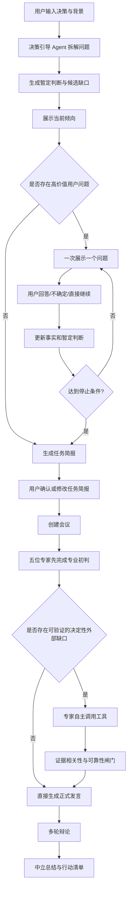

# Decision Council 决策路径 2.0 与专家回答升级 PRD

> 版本：2.0  
> 日期：2026-08-06  
> 状态：产品方案已确认，待开发  
> 适用项目：`/Users/xinyiliu/Desktop/xiegang`  
> 本文性质：基于现有实现的增量升级规范，可直接交给开发者或编码 Agent 实施。

---

## 1. 产品背景

Decision Council 面向个人重大决策用户，通过决策简报、专家独立分析、多轮辩论和中立总结，帮助用户把一句模糊问题转化为可判断、可核实、可执行的决策。

当前产品已经具备：

- 首页输入决策与背景；
- 专家选择；
- 会前任务简报；
- 场景 Playbook；
- 会中追问；
- 五位专家并行调研；
- 有边界的 ReAct 工具调用；
- 2—3 轮辩论和总结。

但当前体验仍存在两个根本问题：

1. **决策路径像一份需要用户完成的问卷。**系统一次生成最多三个问题，前端要求全部作答后才能召开会议；用户不知道真实情况时，容易被迫选择或直接退出。
2. **专家回复不稳定。**Agent 可能在形成专业判断前直接搜索；无关搜索结果、超时和工具失败会污染公开回答；不同专家的专业路径不够稳定，回复容易变短、变泛或失去人物特点。

本次升级需要综合两类优秀体验：

- 像高质量通用 AI 一样，在信息不完整时先给出明确但有边界的暂定方向；
- 像交互式提问工具一样，把真正会改变结论的变量转成低成本选择题；
- 每回答一次，系统重新判断是否还需要继续提问；
- 用户不知道的信息由 Agent 调研、计算、建立情景或加入核实清单，而不是继续向用户索取；
- 专家先依据用户事实形成专业初判，再自主决定是否调用工具。

---

## 2. 一句话目标

用户输入一句模糊的重大决策后，系统先给出一个受条件约束的暂定方向，再用默认不超过两个的动态问题补齐最关键的私人信息，最终让五位专家基于同一份完整简报输出稳定、专业、可核查的判断。

---

## 3. 成功标准

### 3.1 用户体验目标

- 用户在首次输入后快速看到系统对问题的理解和暂定方向，而不是先填表；
- 默认追问 0—2 题，只有结论仍处于临界状态时允许第 3 题；
- 用户可以随时选择“不确定”或“按现有信息继续”；
- 用户不知道的信息不会阻断会议；
- 用户能看到自己的回答是否改变了当前倾向；
- 任务简报可确认、可修改；
- 用户不需要理解 Agent、ReAct、证据账本等技术概念。

### 3.2 专家质量目标

- 每位专家都先形成专业初判，再决定是否调用工具；
- 每位专家最多验证 1—2 个真正会改变结论的外部命题；
- 搜索失败时仍能基于用户事实输出完整的条件性判断；
- 无关网页、重复转载、工具错误和超时信息不得进入正文；
- 每位专家固定输出“立场 → 3 条证据链 → 风险与未知 → 推理小结”；
- 五位专家使用不同的专业路径，而不是同一答案换五种口吻；
- 冲突来自专业方法差异，不通过程序强制分配支持/反对立场。

### 3.3 业务指标建议

- 决策路径打开后完成并进入会议的比例；
- 平均追问数、问题跳过率、“不确定”选择率；
- 从打开决策路径到召开会议的中位时长；
- 用户回答后暂定方向发生变化的比例；
- 会议完整完成率；
- 专家搜索结果的相关率和可引用率；
- 专家回答结构通过率；
- 回答中系统错误文本泄漏率，目标为 0。

---

## 4. 本次范围

### 4.1 P0 必须实现

1. 会前暂定判断；
2. 默认最多两个问题的动态追问；
3. 单题作答后重新判断下一题；
4. “不确定”和“直接召开会议”不阻断流程；
5. 信息责任路由：询问用户、Agent 调研、计算、情景假设、核实清单；
6. 更新后的任务简报确认；
7. 已确认决策路径完整传入所有专家；
8. 专家“先分析、后工具”的受控 ReAct；
9. 专家统一公开回答结构；
10. 无关证据过滤和安全降级；
11. 买房、职业选择、黄金三个核心场景适配；
12. 旧会议和旧客户端兼容。

### 4.2 P1 可后续实现

- 会中由专家提交信息缺口、书记官统一发起一次追问；
- 用户回答会中问题后，只重跑受影响专家；
- 问题价值与用户流失率的在线实验；
- 任务简报跨设备恢复；
- 更多场景 Playbook。

### 4.3 明确不做

- 不展示模型原始思维链；
- 不让五位专家分别弹窗询问用户；
- 不要求用户补齐所有未知信息；
- 不在会前固定专家将搜索什么、调用什么工具；
- 不把模型自报的“置信度百分比”展示给用户；
- 不在本次重做首页、会议室整体视觉和总结页结构；
- 不将所有公开数据预先批量抓取。

---

## 5. 核心产品原则

### 5.1 先给方向，不急着下定论

首次响应必须包含一个简短的暂定判断。它需要：

- 直接说明当前倾向；
- 明确判断仅基于现有信息；
- 指出最多两个可能使结论反转的未知变量；
- 不使用未经验证的精确数据；
- 不替代五位专家的正式分析。

示例：

> 仅凭目前信息，我暂时不建议立即签约，但并不反对买房。家庭收入看起来能够承担贷款，真正的问题是首付后是否还保留足够的现金安全垫，以及你们是否会在这座城市长期生活。

### 5.2 只问最少必要信息

问题必须同时满足：

```text
答案可能改变当前结论
＋ 答案主要掌握在用户本人手中
＋ 用户通常可以在 10 秒内回答
```

否则不向用户提问。

### 5.3 用户不需要替 AI 调研

| 信息类型 | 默认责任方 |
|---|---|
| 用户目标、偏好、承受能力、家庭意见 | 询问用户 |
| 公司融资、房贷政策、市场行情、公开条款 | Agent 调研 |
| 月供、税后差额、现金安全期、盈亏平衡点 | 计算工具 |
| 用户也不知道的私有条款 | 加入核实清单 |
| 无法可靠预测的未来结果 | 情景分析 |
| 不影响结论的信息 | 忽略 |

### 5.4 不知道是有效答案

“不确定”不是异常状态，也不等于必须使用一个武断的保守结论。系统根据问题类型执行以下一种动作：

- `agent_research`：交给专家查询公开信息；
- `due_diligence`：加入用户会后核实清单；
- `scenario_analysis`：分别按乐观、基准、保守情景分析；
- `omit`：该信息价值低，不再处理。

### 5.5 专业判断先于工具

工具只能验证具体命题，不能替代专业分析。任何专家调用工具前，必须已经拥有：

- 暂定立场；
- 三条初步证据链；
- 关键假设；
- 最多两个结论翻转变量。

---

## 6. 端到端用户流程



### 6.1 首屏

用户点击“开始讨论”后，生成阶段文案为：

> 正在理解你的决定……

首次结果展示：

- 任务标题；
- 当前暂定判断；
- 一句话说明哪些变量可能改变判断；
- `补充关键信息`；
- `按现有信息召开会议`。

当没有高价值问题时，不展示“补充关键信息”，直接进入简报确认。

### 6.2 动态问题

- 一次只显示一个问题；
- 展示进度为“已确认 1 项”，不展示固定总题数，避免暗示一定还有多题；
- 预设选项优先，自由输入为补充；
- 选项只描述事实，不夹带建议；
- 必须提供“不确定”；
- 必须提供“按现有信息继续”；
- 每次回答后服务端重新计算下一问题，不在客户端一次保存固定问题列表。

### 6.3 回答后的轻量反馈

每次回答后，只展示一句变化，不重新生成长文：

- `当前倾向未改变：仍建议暂缓。`
- `当前倾向发生变化：现在可以有条件考虑购买。`
- `该信息已加入专家调研。`
- `该信息已加入签约前核实清单。`

### 6.4 任务简报确认

最终简报至少包含：

- 决策目标；
- 比较方案，包括“不行动”或第三方案；
- 已确认事实；
- 用户目标与约束；
- 仍待核实的信息及责任方；
- 当前暂定判断；
- 最终交付。

按钮：

- `同意并召开会议`；
- `修改简报`。

---

## 7. 问题生成与停止规则

### 7.1 问题预算

- 默认上限：2 题；
- 第 3 题仅在结论仍处于临界状态且该问题预计可使结论翻转时出现；
- 会前硬上限：3 题；
- 用户可在任意一步直接继续；
- P1 会中追问默认 0 题，硬上限 1 题；
- 整场硬上限：4 题。

### 7.2 候选问题的内部字段

每个候选问题至少包含：

```json
{
  "id": "holding_horizon",
  "dimension": "time_horizon",
  "question": "你们预计还会在上海生活多久？",
  "answer_type": "range_choice",
  "options": [],
  "source_type": "user_private",
  "conclusion_impact": 0.9,
  "uncertainty": 1.0,
  "user_answerability": 0.95,
  "answer_friction": 0.1,
  "flip_explanation": "短期居住会显著降低购买合理性",
  "unknown_route": "scenario_analysis"
}
```

这些评分仅用于系统排序，不向用户展示。

### 7.3 选择规则

候选问题必须先经过硬过滤：

- `source_type == user_private`；
- `conclusion_impact >= 0.65`；
- `user_answerability >= 0.60`；
- 用户原文和已有答案中未提供；
- 与已提问题不重复；
- 选项之间基本互斥；
- 问题没有内置推荐方向。

过滤后按信息价值排序：

```text
question_value =
0.40 × conclusion_impact
+ 0.25 × uncertainty
+ 0.25 × user_answerability
- 0.10 × answer_friction
```

评分可以由 LLM 提议，但必须由服务端完成范围校验、去重和上限控制。

### 7.4 自动停止条件

符合任一条件立即停止追问：

- 当前事实已经能够形成有条件的明确方向；
- 剩余未知不会改变主结论；
- 已回答两题且不存在高价值临界问题；
- 已达到三题硬上限；
- 用户连续两次选择“不确定”；
- 用户选择“按现有信息继续”；
- 下一个问题只能增加完整度，不能改变建议；
- 所有剩余缺口均应由 Agent、计算或核实清单处理。

### 7.5 暂定判断更新

暂定判断的数据必须区分：

- 当前倾向；
- 适用前提；
- 核心理由；
- 翻转变量；
- 与上一步相比是否变化。

禁止对用户展示数值置信度。内部只保留：

- `unstable`：一个高价值答案即可反转；
- `conditional`：方向明确但依赖条件；
- `stable`：在合理情景范围内方向不变。

---

## 8. 买房场景完整验收样例

### 8.1 输入

> 我和伴侣都在上海工作，家庭税前年收入约90万元，现在有220万元现金。看中一套600万元的房子，准备首付180万元。目前租金每月1.2万元，不知道该不该买。

### 8.2 首次暂定判断

> 仅凭目前信息，我暂时不建议立即签约，但并不反对买房。家庭收入可能能够承担贷款，真正的问题是首付后只剩约40万元，而且还没有计算交易和装修费用；预计居住期限也会明显改变判断。

### 8.3 动态问题一

> 你们预计还会在上海生活多久？

- 2年以内；
- 2—5年；
- 5—10年；
- 10年以上；
- 不确定。

用户选择：`10年以上`。

轻反馈：

> 长期居住提高了买房的使用价值，当前倾向调整为“可以考虑，但需要控制现金风险”。

### 8.4 动态问题二

> 这次买房最主要想解决什么问题？

- 为未来孩子获得稳定居住环境；
- 改善通勤和居住条件；
- 建立长期家庭资产；
- 担心未来房价上涨；
- 家人认为应该买房；
- 不确定；
- 其他。

用户选择：`为未来孩子获得稳定居住环境`。

系统停止追问。贷款利率、交易政策交给 Agent；房屋资格和装修支出进入核实清单。

### 8.5 任务简报预期

```json
{
  "decision_goal": "判断是否应购买上海一套总价600万元的自住房，同时兼顾长期居住、现金安全和家庭生活质量。",
  "decision_options": [
    "现在购买目标房屋",
    "继续租住并积累现金后购买",
    "降低总价或调整区域后购买"
  ],
  "known_facts": [
    "家庭税前年收入约90万元",
    "现有现金约220万元",
    "目标总价600万元",
    "计划首付180万元",
    "当前租金每月1.2万元",
    "预计在上海生活10年以上",
    "主要目标是未来孩子和长期居住稳定"
  ],
  "unresolved_items": [
    {"text": "实际贷款利率和月供", "owner": "agent_research"},
    {"text": "交易及装修完整预算", "owner": "due_diligence"},
    {"text": "产权、入学资格和房屋质量", "owner": "due_diligence"}
  ],
  "provisional_judgment": {
    "label": "有条件考虑",
    "summary": "购房目标成立，但不应在几乎耗尽流动资金的情况下立即签约。"
  }
}
```

### 8.6 最终议会预期方向

> 有条件支持买房，但不建议立即购买当前这套600万元的房子。优先比较降低总价与延后积累现金两条路径，并把完成交易后仍保留足够现金安全垫设为硬条件。

这不是固定答案，而是用于验证全链路是否能正确使用用户事实、计算、外部调研和专业差异。

---

## 9. 决策引导 Agent 设计

### 9.1 定位

决策引导 Agent 是会前调度角色，不是第六位专家，不参与最终投票，也不代表任何专业立场。

职责：

- 理解用户问题；
- 提取明确事实；
- 生成比较方案；
- 给出短暂定判断；
- 提出并排序候选问题；
- 根据答案更新判断；
- 将未知信息分配给正确责任方；
- 生成任务简报。

不职责：

- 不展开完整专家分析；
- 不在会前搜索所有公开信息；
- 不展示思维链；
- 不预测专家将调用的具体工具；
- 不输出未经验证的行业数字。

### 9.2 结构化输出

建议新增：

```python
class ProvisionalJudgment(BaseModel):
    label: Literal["lean_option", "conditional", "hold"]
    recommended_option_id: str | None
    headline: str
    rationale: str
    conditions: list[str]
    flip_variables: list[str]
    stability: Literal["unstable", "conditional", "stable"]
    changed_from_previous: bool = False

class UnresolvedItem(BaseModel):
    id: str
    text: str
    owner: Literal[
        "ask_user", "agent_research", "calculator",
        "due_diligence", "scenario_analysis", "omit"
    ]
    impact: Literal["high", "medium", "low"]

class DecisionPathStepResponse(BaseModel):
    version: Literal["2.0"]
    generation_id: str
    provisional_judgment: ProvisionalJudgment
    next_question: DecisionQuestion | None
    answered_count: int
    can_start_meeting: bool
    brief: DecisionBriefV2 | None
```

### 9.3 Prompt 必须包含的规则

- 先使用用户事实形成暂定判断；
- 信息不足时也要给出有前提的方向；
- 只选择可能改变结论的用户私人信息；
- 不要求用户提供可公开查询的信息；
- 不生成精确概率、收益率、价格阈值，除非输入中已有或已经计算；
- 选项只描述事实，不夹带建议；
- 每次只返回一个 `next_question`；
- 所有未知必须分配责任方；
- 不输出思维链。

---

## 10. 五位专家的统一运行路径

### 10.1 阶段一：读取完整简报

专家必须收到：

- 用户原始问题和背景；
- 决策目标；
- 所有比较方案；
- 所有用户回答；
- 已确认事实；
- 用户偏好和约束；
- 未知信息及其责任方；
- 当前日期。

当前 `parallel_research.py` 不能只传 `brief.summary`、`key_variables` 和原始背景；需要同时传入 `decision_model.user_facts`、`preferences`、`options`、`unknowns` 以及完整 `decision_path_answers`。

### 10.2 阶段二：无工具专业初判

所有专家先完成一个不公开的 `desk_analysis`：

```json
{
  "provisional_stance": "support|oppose|conditional|hold",
  "evidence_chains": [
    {"fact": "...", "analysis": "...", "decision_impact": "..."}
  ],
  "assumptions": [],
  "decisive_gaps": [],
  "reversal_conditions": []
}
```

要求：

- 必须生成三条证据链草稿；
- 不允许先搜索后思考；
- 不允许因为没有网页来源直接选择中立；
- 信息有限时给出条件性判断；
- `desk_analysis` 必须保存，以便超时时安全降级。

### 10.3 阶段三：判断是否需要工具

只有同时满足以下条件才允许调用工具：

```text
该外部事实可能改变结论
＋ 可以通过允许的工具可靠获得
＋ 当前证据尚不足以验证
```

每位专家：

- 最多两个决定性缺口；
- 最多两次工具调用；
- 搜索词必须对应一个明确待验证命题；
- 不得使用用户完整敏感背景作为搜索词；
- 心理学家和艺术家可以零工具完成任务；
- 工具失败后直接进入综合，不循环搜索同义词直至耗尽预算。

### 10.4 阶段四：证据闸门

网页结果进入证据账本前必须检查：

1. 是否直接回答待验证命题；
2. 来源是否可靠；
3. 时间是否适合当前决策；
4. 多个结果是否来自独立来源；
5. 原文是否真的支持拟引用结论。

建议证据状态：

- `accepted`：可以公开引用；
- `weak_signal`：只能作为弱信号；
- `rejected_irrelevant`：不相关；
- `rejected_unreliable`：来源不可靠；
- `conflicting`：不同可靠来源相互冲突。

宁可没有外部来源，也不得使用无关结果。搜索排序分数不能直接等同于证据强度。

### 10.5 阶段五：正式回答

统一公开结构：

```text
我支持。／我反对。／我有条件支持。／目前不建议行动。

证据：
1. 事实 → 专业分析 → 对结论的影响。
2. 事实 → 专业分析 → 对结论的影响。
3. 事实 → 专业分析 → 对结论的影响。

风险与未知：……

推理小结：……
```

禁止使用以下模板标题：

- `我的判断`；
- `我是怎么判断的`；
- `最关键的依据`。

首句必须直接表态。正文中只有“证据”“风险与未知”“推理小结”三个标签。

每条证据链必须包含：

```text
已知事实/可核验数据
→ 本专家的专业分析
→ 为什么支持当前立场
```

建议首轮长度：500—800 个汉字。不能为了达到长度重复或编造事实。

### 10.6 公开依据折叠层

正文保持自然表达；点击“查看分析依据”后展示：

- 用户提供的信息；
- 可复现计算及输入；
- 已通过闸门的网页来源；
- 明确的推断假设。

不展示：

- 原始思维链；
- Reason/Act/Observe 内部步骤全文；
- 工具异常堆栈；
- 被拒绝的垃圾搜索结果。

---

## 11. 五位专家的专属决策路径

### 11.1 数学家

目标：把选项、结果和敏感变量变成可比较结构，避免伪精确。

路径：

1. 明确可选方案和“不行动”方案；
2. 将用户事实转换为变量；
3. 建立简化决策表或情景区间；
4. 找到最敏感变量和结论翻转点；
5. 有真实输入时使用计算器；
6. 只有需要外部基准数据时才搜索；
7. 输出阈值型条件判断。

买房重点：贷款、现金流、剩余安全垫、持有期限和敏感性。

禁止：编造成功率、把不可量化价值当作零、使用无输入支撑的精确阈值。

### 11.2 经济学家

目标：比较真实替代方案、机会成本、激励、流动性和可逆性。

路径：

1. 明确每个方案真正放弃了什么；
2. 分离现金成本、非现金成本和机会成本；
3. 分析各方激励是否一致；
4. 比较可逆性和选择权价值；
5. 计算边际收益与风险补偿；
6. 必要时调研市场、薪酬、融资或政策；
7. 给出条件性资源配置建议。

买房重点：首付机会成本、租买差额、资产集中和退出成本。

禁止：把市场价格等同于个人价值、把金钱当作唯一尺度。

### 11.3 心理学家

目标：区分真实价值、情绪需求、社会压力与认知偏差。

路径：

1. 识别用户想获得什么、害怕失去什么；
2. 区分长期价值与短期焦虑；
3. 只根据用户表达检查可能的认知偏差；
4. 分析身份认同、关系和后悔成本；
5. 使用未来回看或可逆性测试；
6. 通常不需要网页搜索；
7. 给出尊重用户自主性的条件判断。

买房重点：稳定感是否真实、错失恐惧、双方价值是否一致、负债压力是否抵消安全感。

禁止：医学诊断、替用户定义情绪、把谨慎自动视为正确。

### 11.4 政治学家

目标：分析利益相关者、权力、筹码、执行阻力和谈判空间。

路径：

1. 绘制关键相关者；
2. 区分各方公开目标和真实激励；
3. 分析谁拥有决定权、否决权和信息优势；
4. 找出可以谈判的条件；
5. 检查执行中可能出现的冲突；
6. 只有涉及公开政策、治理或规则时搜索；
7. 输出谈判与执行条件。

买房重点：伴侣和父母出资、产权、银行、中介、卖方、学区资格和合同责任。

禁止：把所有关系理解为算计、将操纵包装成谈判。

### 11.5 艺术家

目标：重构题目，创造第三选项，描述选择对应的生活体验。

路径：

1. 检查问题是否被错误限制为二选一；
2. 识别用户真正想创造的生活；
3. 生成 1—2 个现实可行的第三方案；
4. 用未来场景比较不同路径；
5. 用现实约束过滤空想；
6. 通常不需要网页搜索；
7. 给出可小规模验证的替代路径。

买房重点：降低总价、调整区域、先租后买、目标区域试住，以及未来十年的生活叙事。

禁止：为了创新忽略现金、时间和家庭约束。

### 11.6 关于历史学家

历史学家可继续作为可选第六位专家，但不纳入默认五人 P0 验收。其核心职责是提供可比案例、基准概率和类比边界。历史案例必须有可靠来源，且必须明确“今天与案例不同的条件”。

---

## 12. 专家冲突与辩论规则

### 12.1 不强制立场分散

删除或关闭“为了避免五人扎堆而强制某位专家改成支持/反对”的逻辑。议会职责可以改变审查重点，但不能预设最终立场。

允许五位专家在证据充分时得出相同方向。产品魅力来自理由差异和真实分歧，不来自人工制造冲突。

### 12.2 2—3 轮辩论

- 第 1 轮：指出其他专家论证中最关键的冲突或遗漏；
- 第 2 轮：回应质疑，修正立场或补充条件；
- 第 3 轮：只有仍存在会改变最终建议的核心分歧时才触发。

每轮不得重复首轮完整观点。调度器先提取分歧，再把具体分歧分配给相关专家。

### 12.3 辩论输出建议

- 第 1 轮：220—350 字；
- 第 2 轮：150—250 字；
- 第 3 轮：100—180 字；
- 必须引用对方的具体观点；
- 必须说明自己维持、修正还是反转立场；
- 不为每轮强制新增搜索。

---

## 13. 降级与错误处理

### 13.1 安全降级顺序

```text
完整专业初判
→ 可用工具证据
→ 工具失败则舍弃失败结果
→ 基于 desk_analysis 形成条件性正式回答
```

不得使用当前“取前两条搜索摘要拼成 thesis”的降级方式。

### 13.2 用户可见内容禁止项

以下文本不得出现在专家正文：

- `TimeoutError`；
- `Agent 总运行时间已达到上限`；
- `工具暂时不可用`；
- `本轮调研未完成`；
- `[RESEARCH ERROR]`；
- 原始异常字符串；
- 无关网页摘要。

必要时仅在专家状态旁显示：

> 本轮基于已确认信息完成分析。

### 13.3 超时预算

建议将“专业初判”和“工具调研”分开计时：

- 专业初判：独立短调用，优先保证落盘；
- 单工具：15 秒；
- 工具总预算：30 秒；
- 最终综合：独立短调用；
- 总超时发生时，直接使用已落盘的专业初判，不再调用模型拼接原始片段。

---

## 14. API 与数据结构改造

### 14.1 保留接口

- `POST /api/decision-path/preview`；
- `GET /api/decision-path/{generation_id}`；
- `DELETE /api/decision-path/{generation_id}`；
- 现有带 `decision_path_generation_id` 的会议创建接口。

### 14.2 新增逐步回答接口

`POST /api/decision-path/{generation_id}/answer`

请求：

```json
{
  "question_id": "holding_horizon",
  "value": "gte_10",
  "custom_value": null,
  "revision": 1
}
```

响应：

```json
{
  "version": "2.0",
  "generation_id": "dp_xxx",
  "revision": 2,
  "provisional_judgment": {},
  "feedback_message": "长期居住提高了买房的使用价值。",
  "next_question": {},
  "answered_count": 1,
  "can_start_meeting": true,
  "brief": null
}
```

### 14.3 新增直接继续接口或动作

可以新增：

`POST /api/decision-path/{generation_id}/continue`

也可以在回答接口中使用：

```json
{"action": "continue_with_current_information"}
```

服务端必须：

- 停止生成用户问题；
- 路由剩余未知；
- 生成最终简报；
- 允许用户确认并创建会议。

### 14.4 草稿 payload 版本

新增 `version = 2.0`，至少保存：

```json
{
  "version": "2.0",
  "category": "real_estate",
  "brief": {},
  "extracted_facts": [],
  "answers": [],
  "asked_question_ids": [],
  "candidate_questions": [],
  "provisional_judgment": {},
  "unresolved_items": [],
  "question_budget": {
    "default": 2,
    "hard_limit": 3,
    "unknown_count": 0
  },
  "status": "asking|ready_to_confirm|confirmed|expired"
}
```

更新必须校验 `revision`，防止连续点击或网络重试覆盖新答案。

### 14.5 兼容策略

- v1 草稿继续按原结构恢复；
- v2 前端只对 `version == 2.0` 使用逐题流程；
- 老会议缺少新字段时继续读取；
- 数据库优先复用 `decision_path_drafts.payload` JSONB，不要求 P0 新增表；
- 创建会议后写入完整 v2 `decision_path`，不得只写最终问题答案。

---

## 15. 前端改造要求

### 15.1 当前问题

现有 `DecisionPathModal.tsx`：

- 同时渲染全部 `preview.questions`；
- `allAnswered` 要求所有问题有答案；
- `canConfirm` 依赖全部问题完成；
- 问题不会根据前一答案更新；
- “不确定”会直接展示系统保守假设，容易让用户误认为结论已经固定。

### 15.2 新状态机

```text
idle
→ generating_initial
→ showing_provisional
→ answering_question
→ updating_after_answer
→ ready_to_confirm
→ revising_brief
→ creating_meeting
→ create_failed
```

### 15.3 组件建议

- `DecisionPathModal.tsx`：负责整体状态；
- `ProvisionalJudgmentCard.tsx`：暂定判断；
- `DecisionQuestionStep.tsx`：单题选择；
- `DecisionBriefCard.tsx`：最终简报；
- `UnresolvedItems.tsx`：显示“专家调研/需要你核实/按情景分析”；
- 复用现有颜色、圆角和按钮语言，不重新引入一套视觉系统。

### 15.4 交互细节

- 弹窗高度不得依赖一次塞入全部内容；
- 每题选项可键盘操作；
- 回答过程中关闭弹窗，草稿可恢复；
- 请求失败保留当前答案；
- 用户选择“不确定”后立即继续，不展示惩罚性警告；
- 用户选择“按现有信息继续”后不再出现会前问题；
- 简报确认和回答问题是两个不同动作；
- 不使用“同意”提交事实；“同意”只用于确认任务简报。

---

## 16. 后端代码改造位置

### 16.1 决策路径

- `backend/app/services/decision_path.py`
  - 由“一次生成简报和最多3题”改为“生成暂定判断、候选池和单个下一题”；
  - 增加回答后的重评估；
  - 增加停止条件与未知路由；
  - fallback 不再固定取 Playbook 前3题，最多选择一个最高优先级问题，也允许零问题。

- `backend/app/schemas/decision_path.py`
  - 增加 `ProvisionalJudgment`、`UnresolvedItem`、`DecisionPathStepResponse`；
  - `DecisionBrief` 增加已知事实、用户目标约束、未知责任方和暂定判断；
  - 新增 answer/continue 请求模型；
  - 保留 v1 schema 兼容。

- `backend/app/playbooks/__init__.py`
  - 为候选问题增加信息来源、影响、可回答性、摩擦和 unknown route；
  - 校准选项中立性；
  - 默认问题预算改为2；
  - 买房、职业和黄金分别补充场景变量。

- `backend/app/api/decision_path.py`
  - 新增逐题回答与直接继续接口；
  - 增加 revision/idempotency 校验。

### 16.2 专家 Agent

- `backend/app/graph/nodes/parallel_research.py`
  - 构造完整 `user_brief`；
  - 注入所有用户答案和决策模型字段；
  - 不再只使用 topic 作为 Agent goal；
  - 每个专家完成一个展示一个；
  - 删除系统错误进入公开发言的路径。

- `backend/app/agents/research_graph.py`
  - 在 ReAct 前增加并持久化 `desk_analysis`；
  - 工具调用只验证决定性缺口；
  - forced fallback 使用 `desk_analysis`；
  - 删除原始 evidence snippet 拼接 thesis；
  - 最终结果适配四段公开结构。

- `backend/app/agents/evidence.py`
  - 增加命题相关性、来源可靠性、时效、独立性和 claim match；
  - 搜索 provider score 不再直接等于强证据；
  - 记录被拒绝原因，但不公开展示垃圾结果。

- `backend/app/agents/profiles.py`
  - 将五位专家的专属路径写入 profile；
  - 保留人格与长范例；
  - 删除或停用强制 stance hint；
  - 议会 duty 只影响审查重点。

- `backend/app/agents/schemas.py`
  - 增加 `DeskAnalysis` 和三条 `EvidenceChain`；
  - stance 支持条件性判断；
  - 公开结果不依赖数值 confidence。

- `backend/app/agents/harness.py`
  - 将初判、工具、综合分开预算；
  - 保障初判优先保存；
  - 工具失败立即返回可综合状态。

### 16.3 前端

- `frontend/components/council/DecisionPathModal.tsx`；
- `frontend/lib/api.ts`；
- `frontend/lib/types.ts`；
- 新增上述拆分组件；
- `frontend/app/parliament/[id]/page.tsx` 兼容 P1 会中单题追问；
- 专家卡正文渲染适配新的四段文本；
- “查看分析依据”继续使用折叠层。

---

## 17. Prompt 与内容约束

### 17.1 暂定判断禁止项

- 没有来源的行业失败率；
- 没有计算的税后金额；
- 没有用户依据的风险偏好；
- 没有条件说明的绝对建议；
- 长篇全面分析；
- 冒充五位专家的正式结论。

### 17.2 问题选项禁止项

错误：

> 遇到晋升瓶颈——不要轻易走，先尝试内部解决。

正确：

> 当前晋升受阻或业务影响力下降。

选项只能收集事实或偏好，不能提前教育用户应该选择什么。

### 17.3 证据链规则

三条证据链分别优先承担：

1. 最直接支持立场的事实与分析；
2. 当前方案被忽略的成本、风险或价值；
3. 与替代方案或“不行动”方案的比较。

“网页来源”不等于“证据链”。网页只提供事实，专家必须解释该事实如何影响选择。

---

## 18. 埋点

新增或调整：

- `decision_path_initial_generated`；
- `provisional_judgment_viewed`；
- `provisional_judgment_changed`；
- `decision_question_viewed`；
- `decision_question_answered`；
- `decision_question_unknown_selected`；
- `decision_path_continue_without_answer`；
- `decision_path_question_stopped`，带 stop reason；
- `decision_brief_confirmed`；
- `decision_brief_revised`；
- `expert_desk_analysis_completed`；
- `expert_tool_decision`，记录 call/skip，不记录私密推理；
- `evidence_accepted`；
- `evidence_rejected`，记录类别；
- `expert_safe_fallback_used`；
- `public_system_error_leaked`，目标永远为0。

埋点不得记录用户敏感原文、搜索敏感词全文或内部思维链。

---

## 19. 测试与验收

### 19.1 决策路径单元测试

1. 用户已提供完整信息时返回0题；
2. 普通模糊输入最多返回2题；
3. 只有临界状态允许第3题；
4. 连续两次“不确定”后停止；
5. 用户直接继续后不再返回问题；
6. 公开信息被路由到 `agent_research`，不得询问用户；
7. 用户不知道的私有条款进入 `due_diligence`；
8. 选项不包含建议性描述；
9. 重复问题被去重；
10. revision 冲突不会覆盖新答案；
11. fallback 允许零题且不会固定吐出前三题；
12. 暂定判断不包含无依据的精确数字。

### 19.2 专家 Agent 单元测试

1. 所有专家在工具前生成 `desk_analysis`；
2. 信息足够时专家可以零工具完成；
3. 搜索命题必须对应决定性缺口；
4. 心理学家不会为跳槽问题搜索无关校招信息；
5. 数学家不会为跳槽问题搜索无关实习薪资；
6. 无关网页不进入证据账本；
7. 转载内容不会被当作多个独立来源；
8. 工具超时仍输出基于用户事实的完整四段回答；
9. 正文不出现异常字符串；
10. 每位专家恰有三条证据链；
11. 每条证据链包含事实、专业分析和决策影响；
12. 不强制制造立场分散。

### 19.3 端到端场景

至少测试：

- 买房：本 PRD 第8章案例；
- 跳槽：字节50万元与初创70万元；
- 黄金：用户只说“现在要不要买黄金”；
- 用户首屏直接召开会议；
- 用户两次选择不确定；
- Web Search 完全不可用；
- 单个专家超时；
- 页面刷新后恢复决策路径；
- 重复提交答案；
- 旧会议打开。

### 19.4 内容验收红线

出现以下任一情况即不通过：

- 用户必须回答全部问题才能继续；
- 默认提问超过2题；
- 用户被要求提供公开可查信息；
- 问题选项包含推荐结论；
- 专家用无关网页作为核心依据；
- 工具错误出现在正文；
- 专家以“暂不作绝对判断”回避方向；
- 五位专家只是同一段回答换名字；
- 总结页展示详细 ReAct 工作路径。

---

## 20. 实施顺序

### 阶段一：会前决策路径 2.0

- 扩展 schema 和草稿版本；
- 生成暂定判断；
- 单题回答接口；
- 问题预算和停止规则；
- 未知责任路由；
- 前端逐题交互；
- 买房场景验收。

### 阶段二：专家稳定性

- 完整简报透传；
- `desk_analysis`；
- 工具选择规则；
- 安全 fallback；
- 四段回答结构；
- 五位专家专属路径。

### 阶段三：证据质量与辩论

- 证据闸门；
- 去除强制 stance；
- 基于真实分歧的2—3轮辩论；
- 来源折叠层校准。

### 阶段四：P1 会中追问与指标优化

- 专家提交缺口；
- 书记官合并；
- 最多一次会中问题；
- 只重跑受影响专家；
- 埋点和A/B实验。

---

## 21. Definition of Done

以下条件全部满足才算本次升级完成：

1. 用户输入模糊问题后能先看到暂定方向；
2. 用户可以不回答任何问题直接召开会议；
3. 系统默认最多询问两个高价值问题；
4. 每回答一题后下一题会动态变化或自动停止；
5. 用户选择“不确定”不会阻断流程；
6. 任务简报完整保存用户事实、回答、未知及责任方；
7. 五位专家收到同一份完整简报；
8. 五位专家先分析后决定是否调用工具；
9. 每位专家按规定的四段结构输出；
10. 搜索失败和超时不会破坏公开回答；
11. 无关搜索结果不会作为证据；
12. 买房、跳槽、黄金三个端到端用例通过；
13. 旧会议和旧数据可以正常打开；
14. 总结页不显示详细 Agent 工作路径；
15. 所有自动化测试通过，并完成一次真实浏览器全流程验收。

